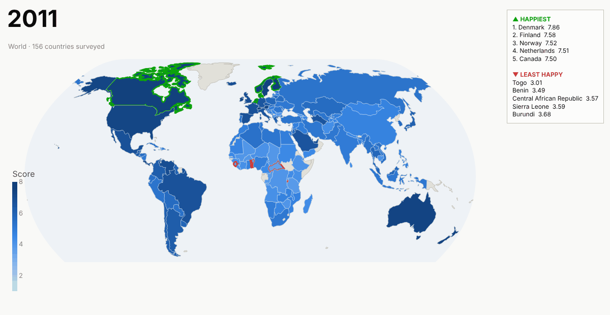

# World Happiness Atlas

<p align="center">
  <picture>
    <source media="(prefers-color-scheme: dark)" srcset="docs/assets/happiness_world_timeline_dark.gif">
    
  </picture>
</p>


[](https://<your-app>.streamlit.app)
[](https://github.com/aadinoyiibrahim/world-happiness2/actions/workflows/ci.yml)
[](https://codecov.io/gh/aadinoyiibrahim/world-happiness2)
[](pyproject.toml)
[](LICENSE)
[](https://github.com/astral-sh/uv)
[](https://github.com/astral-sh/ruff)
[](https://mypy-lang.org/)

An interactive Streamlit dashboard and a tested Python package for the World Happiness
Report (WHR) 2026 *Data for Figure 2.1*: life evaluations for 167 countries, 2011–2025.

**Dashboard features**

- **Scope buttons**: 🌍 World, Africa, Asia, Europe, North America, South America, Oceania.
- **▲ Top / ▼ Worst** with **3 / 5 / 10** countries, for any year.
- **Live map** that is always moving:
  - *Timeline* loops through every year, with green and red rings marking that year's top
    and bottom N and a ranking card that updates each year.
  - *Globe* spins the world, or sways around the selected continent.
  - Hovering or dragging pauses the map; there is also a pause button and a year scrubber.
- **Compare continents**:
  - the gap between the happiest and least happy country in each continent;
  - the distribution of every country's score;
  - continent means over time;
  - side-by-side top/worst-N tables.
- **Why the gaps?** Each WHR score is six "explained by" parts plus a residual, so any gap
  splits exactly into those parts. This tab breaks down:
  - the best vs worst continent: which factors make up the gap, whether that changes over
    time, and whether it is broad or driven by a few countries;
  - inside any continent, its happiest vs least happy country, against the continent and
    world means.

  Each view comes with a plain-language summary, a "what to expect" check and the limits
  of the method.

<!--

- **Data tab** follows the selected scope and year, hides columns that are empty (the
  factor breakdown starts in 2019) and downloads as CSV.
- **Light / dark theme**: switch with the ☀/☾ button or ⋮ → Settings; charts and map follow.
  The default follows the viewer's OS.
- **Shareable URLs**: every control is saved in the address bar, for example
  `?scope=Europe&show=worst&n=5&year=2025&map=globe`.


## Animated map for READMEs and slides

GitHub cannot run the live map's JavaScript, so it is exported as a GIF. Each frame is the
same Plotly figure the app shows, rendered by Kaleido (which uses Chrome) and joined with
Pillow.

```bash
uv sync --extra export
uv run wh export-map                                    # world, timeline, dark
uv run wh export-map --theme light                      # light variant
uv run wh export-map --mode globe --scope Europe        # rocking globe over Europe
```

Files land in `docs/assets/` as `happiness_<scope>_<mode>_<theme>.gif`. The world timeline
is about 1 MB; a 36-frame globe is about 3.5 MB. Regenerate the GIFs when the data changes.

-->

## Run it

You need [uv](https://docs.astral.sh/uv/).

```bash
uv sync                          # dashboard only (lean: no ML libraries)
uv run wh explore                # http://localhost:8501
```

The modelling pipeline and the Dash results app are optional extras:

```bash
uv sync --all-extras             # + scikit-learn, xgboost, dash, dowhy
uv run wh run                    # data -> features -> model -> causal, writes outputs/
uv run wh results                # Dash results on http://localhost:8050
```

## Deploy

| Target | How |
|---|---|
| **Streamlit Community Cloud** | New app → this repo, branch `main`, main file `streamlit_app.py`. It installs the core dependencies from `uv.lock`; the theme comes from `.streamlit/config.toml`. |
| **Docker / any VM** | `docker compose up --build -d dashboard` serves on port 8501, restarts automatically and has a health check. `docker compose up --build` also runs the pipeline and the Dash results app. |
| **Render / Fly / Cloud Run** | Build the `Dockerfile`; the default command starts the dashboard on port 8501. |

The map loads Plotly's JavaScript and country shapes from `cdn.plot.ly`, so the viewer's
browser needs internet access.

## Layout

```
streamlit_app.py      Deployment entry point (runs apps/dashboard.py)
.streamlit/           Theme and server settings
src/world_happiness/
  config.py           Settings (paths, env overrides) and column names
  countries.py        name -> ISO3 -> continent (6) and WHR region (10)
  data.py             WHRDataset: load, harmonise, validate (pandera schema)
  analysis.py         Explorer: scoped rankings, continent summaries, gap decomposition
  insights.py         Plain-language reading of a gap decomposition
  livemap.py/.html    The animated map: frames built in Python, looped in the browser
  charts.py, theme.py Dashboard charts and the light/dark colour system
  apps/dashboard.py   Streamlit app (apps/why.py = the "Why the gaps?" tab)
  features.py, model.py, causal.py, pipeline.py, plots.py, apps/results.py
                      Modelling pipeline and Dash results app (the `ml` and `causal` extras)
  cli.py              `wh` command
tests/                pytest suite: synthetic fixtures, one real-data test, Streamlit AppTest
```

## Development

```bash
uv sync --all-extras
uv run pre-commit install        # ruff lint + format on every commit
uv run pytest                    # tests + coverage
uv run ruff check . && uv run mypy
```

CI (`.github/workflows/ci.yml`) runs these checks:

- lint and type checks;
- tests on Python 3.10 and 3.12;
- a *dashboard-only* job that installs exactly what Streamlit Cloud installs and boots the app;
- a Docker smoke test.

## Data and caveats

- **Source:** `data/raw/WHR26_Data_Figure_2.1.xlsx` comes from
  [worldhappiness.report/data-sharing](https://www.worldhappiness.report/data-sharing/).
- **Score:** the Cantril-ladder life evaluation (0–10), averaged over three years. `year` is
  the last of those years, and there is no 2013.
- **Rankings:** whiskers on the bars are WHR's 95% confidence intervals. Countries whose
  intervals overlap are not reliably ordered.
- **Continents:** the seven-continent split, without Antarctica.
  - North America includes Central America and the Caribbean.
  - Russia counts as Europe and Türkiye as Asia.
  - Oceania holds only Australia and New Zealand.
- **Means over time:** each mean covers the countries surveyed that year, and that set
  changes from year to year.
- **Model and causal results:** read [MODEL_CARD.md](MODEL_CARD.md) before interpreting them.

## Citation

See [CITATION.cff](CITATION.cff). Licence: MIT.
